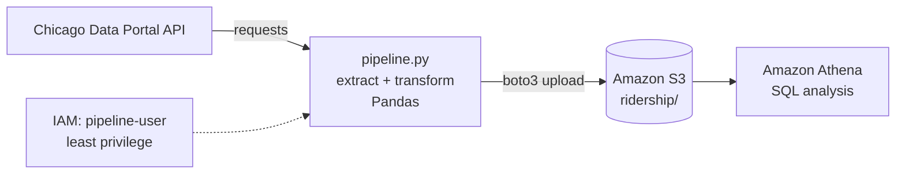

# Chicago Transit Data Pipeline

A Python and AWS data pipeline that pulls 187K+ daily CTA 'L' ridership records from the Chicago Data Portal API, cleans them with Pandas, loads them into Amazon S3, and analyzes them with SQL in Amazon Athena.

## Architecture



1. **Extract:** `pipeline.py` calls the Chicago Data Portal API for CTA 'L' station entries from January 2023 onward.
2. **Transform:** Pandas converts dates and ride counts to proper types, removes missing and duplicate rows, renames columns, and replaces day-type codes with readable labels.
3. **Load:** boto3 uploads the clean CSV to an S3 bucket.
4. **Analyze:** Athena reads the S3 data through an external table, and a view casts columns to their correct types for SQL analysis.

## Tech stack

Python · Pandas · requests · boto3 · Amazon S3 · AWS IAM · Amazon Athena · SQL · Git

## Key findings

Data covers January 2023 through July 2026 (about 188,000 station-day records).

- **Ridership is growing steadily.** Total 'L' rides rose from 99.8M in 2023 to 117.5M in 2025, an increase of 17.7%, or about 8.5% per year. January–July 2026 is up another 4.9% from the same months in 2025.
- **Weekdays carry the system.** An average weekday has about 337,600 rides, 1.3x a Saturday (251,700) and 1.8x a Sunday or holiday (189,300).
- **The Loop and O'Hare are the busiest stations.** In 2025, Lake/State led with 3.6M rides, followed by O'Hare Airport (3.3M) and Clark/Lake (3.2M).
- **The South Side Red Line grew fastest.** Among stations with 100K+ rides in 2024, Cermak-Chinatown (+48.6%), Sox-35th (+36.3%), and 47th (+36.0%) had the biggest gains in 2025. (Damen on the Green Line shows +179%, but it opened partway through 2024, so its 2024 total covers only part of the year.)
- **Big events set ridership records.** The busiest day in the dataset was July 30, 2026 (501,090 rides). Several of the top 10 days fall during Lollapalooza weekends, on St. Patrick's Day parade Saturdays, and on Chicago Marathon day (October 12, 2025).
- **Ridership is seasonal.** October is the peak month each year, and January and February are the lowest.

## Repository structure

```
chicago-transit-pipeline/
├── pipeline.py          # Extract, transform, and load
├── sql/
│   ├── setup.sql        # Athena database, external table, and view
│   └── analysis.sql     # Five analysis queries
├── requirements.txt
└── .gitignore           # Keeps data/ and venv/ out of Git
```

## SQL techniques used

| Query | Question | Technique |
| --- | --- | --- |
| Q1 | Busiest stations in 2025 | Filtering, aggregation, sorting |
| Q2 | Monthly ridership trend | Date functions (`date_trunc`) |
| Q3 | Weekday vs. weekend demand | Subquery |
| Q4 | Fastest-growing stations | CTE and self-join |
| Q5 | Busiest days systemwide | Window function (`RANK() OVER`) |

## How to run it

**Prerequisites:** Python 3, an AWS account, and the AWS CLI.

```bash
git clone <this-repo-url>
cd chicago-transit-pipeline
python3 -m venv venv
source venv/bin/activate
pip install -r requirements.txt
```

1. Create an S3 bucket, and set `BUCKET` in `pipeline.py` to its name.
2. Create an IAM user with a policy that allows only `s3:ListBucket` on the bucket and `s3:PutObject` / `s3:GetObject` on its objects.
3. Save that user's access keys locally:

   ```bash
   aws configure --profile pipeline
   ```

4. Run the pipeline:

   ```bash
   python pipeline.py
   ```

5. In Athena, run `sql/setup.sql` one statement at a time, then the queries in `sql/analysis.sql`.

## Security

The pipeline uses a dedicated IAM user whose policy grants access to a single S3 bucket and nothing else. I tested this by trying to list all buckets with that user, and AWS denied the request. Credentials are stored in a local AWS CLI profile and never appear in the code or the repository.

## What I'd add next

- Run the pipeline on a daily schedule with AWS Lambda and EventBridge
- Store the data as partitioned Parquet files to make Athena queries faster and cheaper
- Add unit tests for `transform()` with pytest
- Build a dashboard of ridership trends
